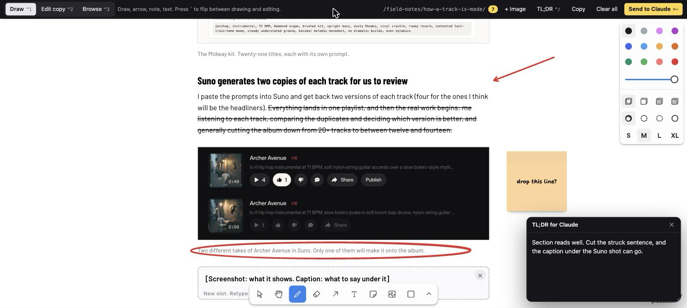

# Markup

I'd ask Claude Code for a landing page, it would hand me back a hero, three feature sections, and a pricing table, and I'd end up typing something like "the second paragraph under the headline, the one that starts with 'We help teams'..." before losing steam.

Claude Code produces more pages and copy than I can keep up with in chat, and describing a visual change in prose is exactly where my feedback stalled. What I wanted was to mark up the page the way I'd mark up a printout and hand it back.

This plugin puts a [tldraw](https://tldraw.dev) canvas over any local page so you can draw arrows, scribble notes, and retype the copy right where it sits. Then one keystroke hands it all to Claude.



## Get it running in Claude Code

The plugin is named `markup-review` and lives in a marketplace named `markup`. In Claude Code, run:

```
/plugin marketplace add kkoppenhaver/markup
/plugin install markup-review@markup
```

Or from a local checkout:

```
claude --plugin-dir /path/to/markup
```

The plugin includes a mod (a hooks module that runs inside Claude Code), which needs **Claude Code 2.1.290 or later**. The server needs **Python 3.8 or later**. There are no other dependencies, since tldraw loads from a CDN.

## Open any page for review with one command

Run `/markup` in Claude Code and it starts the bundled server, opens the review page in your browser, and adds a Review pane beside the chat.

```
/markup                               serve the project folder
/markup dist                          serve a built folder
/markup http://localhost:3000         proxy a running dev server
/markup --page /pricing               open a specific page
```

Claude also gets two tools, `review_open` and `review_notes`, so saying "let me mark this up" works too.

The page under review stays current. With a dev server behind the proxy, its hot reload channel passes through, so the frame updates the way the plain page would. With a folder, the server watches it and reloads the frame when a file changes, which is how you see Claude's edits land after you send a round. Your marks, retyped text and placed screenshots survive the reload.

## Mark it up like a printout

The review page has three modes:

- **Draw** (Ctrl+1) gives you the tldraw tools: D pen, A arrow, N sticky note, T text, R rectangle, E eraser, and V select.
- **Edit copy** (Ctrl+2, or the backtick key) lets you click into any text and retype it. Cmd+Shift+X strikes words out.
- **Browse** (Ctrl+3) makes the page behave normally again.

Screenshots go straight into the page. Drag an image file onto the spot where it belongs, or paste one with Cmd+V, and it appears there as a figure with a caption you can edit, so you see how the text flows around it. Any `[Screenshot: ...]` placeholder line on the page shows up as a dashed drop zone that lights up while you drag; drop there to replace the line, or drop on an existing image to replace that image.

For the big-picture verdict, Ctrl+/ opens the **TL;DR** box.

## Send it with Cmd+Enter

When you're done, press **Cmd+Enter**. The notes land in `.review/inbox/` in your project as a markdown file, a JSON file, a PNG of the strokes, and one file per screenshot you placed.

The mod sees the file within a second, shows a toast, and starts a Claude turn with the notes, so pressing Cmd+Enter in the browser is the same as typing a message. The Review pane lists each round and marks it applied when the turn ends.

If the mod isn't loaded, a prompt hook carries any unread notes along with your next message instead.

## Notes Claude can act on

Claude gets your TL;DR, each copy edit as a CSS selector with the before and after text (`~~text~~` means delete, and an element you removed outright is listed as deleted), and each mark (arrow, scribble, note, or text) with the element it points at. A pen tap a few pixels wide is reported as a dot, so Claude knows to treat it as a stray. Here's what a round looks like:

```
page: /pricing
## TL;DR
Too much copy above the fold. Cut the second paragraph.
## Copy edits (1)
- `section#hero > p:nth-of-type(2)`
  - before: We help teams ship faster with less friction.
  - after: ~~We help teams ship faster with less friction.~~
- `section#hero > h2:nth-of-type(2)`
  - before: Trusted by teams everywhere
  - deleted: the whole element is gone from the page
## Marks on the page (2, top to bottom)
1. arrow on `h1` ("Pricing that scales")
2. note: "make this the headline" on `h2:nth-of-type(1)` ("Simple, honest plans")
## Images (1)
1. `kit.png` (2880×1640, 2x screen) replacing the placeholder `main > p:nth-of-type(6)` ("[Screenshot: the album kit…")
   - file: /project/.review/inbox/20261106-013000-pricing-img-1.png
   - caption: The Midway kit. Twenty-one titles, each with its own prompt.
```

It also reads the PNG, since the strokes show things the text can't (like what you circled).

## Everything stays on your machine

Nothing leaves your computer. The server binds to 127.0.0.1.

## Run the server by hand

You can also start the server yourself:

```
python3 scripts/review_server.py --root ./dist --port 8791 --open
python3 scripts/review_server.py --proxy http://localhost:3000 --path /pricing --open
```

The review layer lives at `/__review/?url=<page>`. Notes go to `./.review/inbox/` under whatever directory you ran it from, and you can change that with `--inbox`.

## Find your way around the code

```
markup/
├── .claude-plugin/plugin.json      manifest
├── .claude-plugin/marketplace.json  so this repo installs as a marketplace
├── hooks/hooks.json                names the mod module, plus the fallback prompt hook
├── hooks/register.tsx              the mod: /markup, review_open and review_notes tools, inbox watcher, Review pane
├── types/index.d.ts                the mod's state contract
├── skills/markup-review/SKILL.md   how Claude applies notes
├── scripts/review_server.py        static server or dev-server proxy, plus the inbox endpoint
├── scripts/inject_notes.py         fallback hook for sessions without mods
├── scripts/watch_inbox.py          fallback watcher for sessions without mods
└── assets/review.html, review.js   the tldraw layer
```

The mod is what makes it feel seamless. It owns the server process for the session, polls the inbox, and submits arriving notes as a prompt. The skill and scripts work without it.

## Rough edges I know about

- tldraw shows a small "get a license" badge in local use, and a tldraw license removes it.
- Copy edits map to a CSS selector. Turning that into the right component in your codebase is Claude's job, and it uses the selector plus the surrounding text to get there.
- It's built for mouse and trackpad. Touch works, but it isn't designed for it.
- There is no button for "drop this screenshot slot" or "add an image here". Today you delete a placeholder line in edit mode like any other text, and you add an image where there is no placeholder by dropping it on the paragraph it should follow. Both work, neither is discoverable. A small control on each placeholder and a way to insert an empty slot are on the list.

## Give it a try

Install it, run `/markup` on whatever Claude built for you last, and scribble on it. I'd love to hear what you'd want next, so open an issue on our repo at `https://github.com/kkoppenhaver/markup` and tell me about it.
